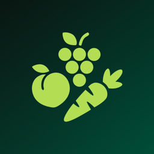
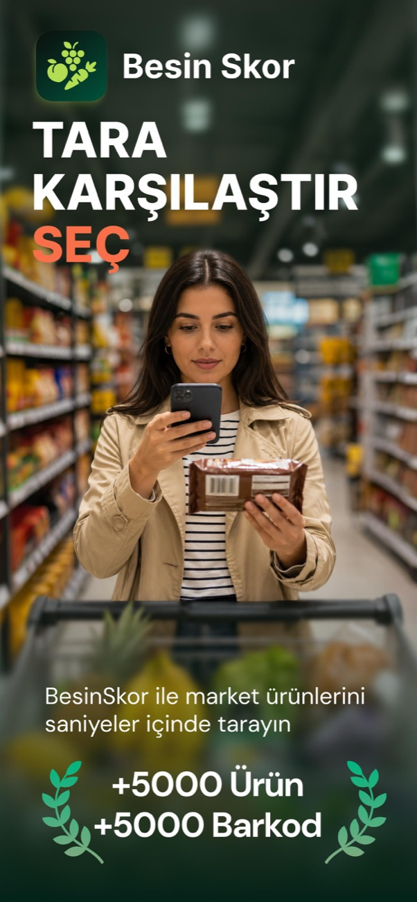
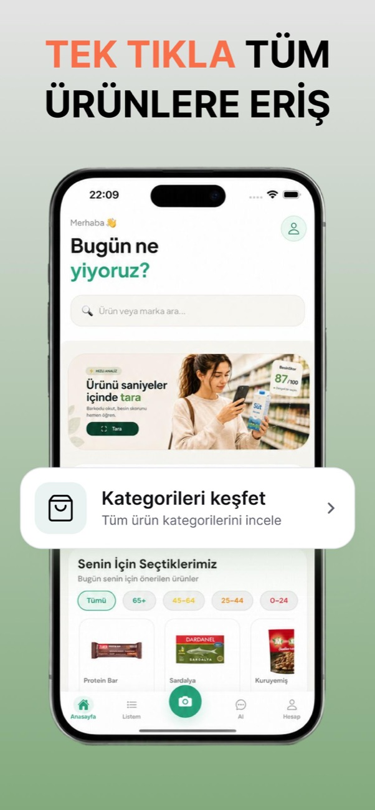
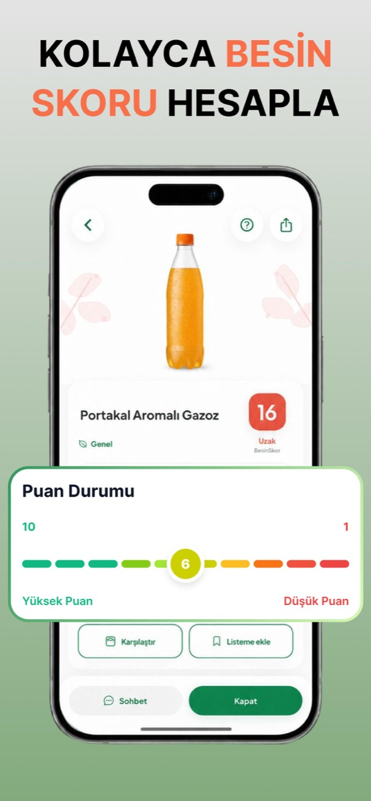
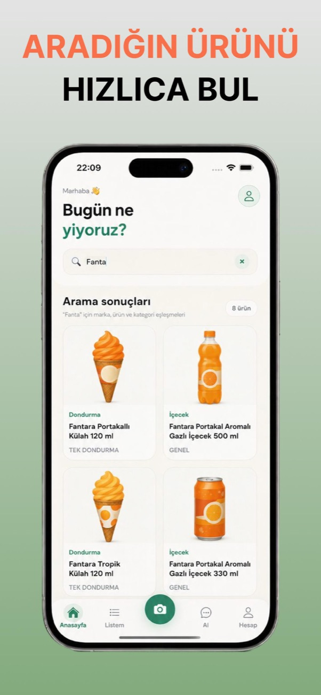
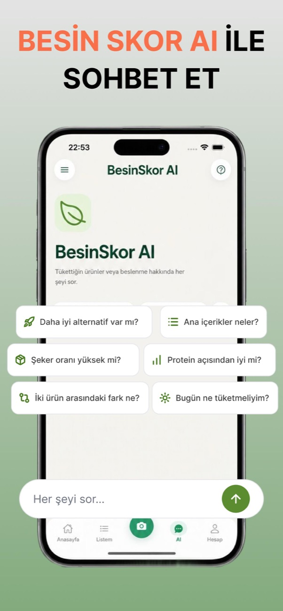
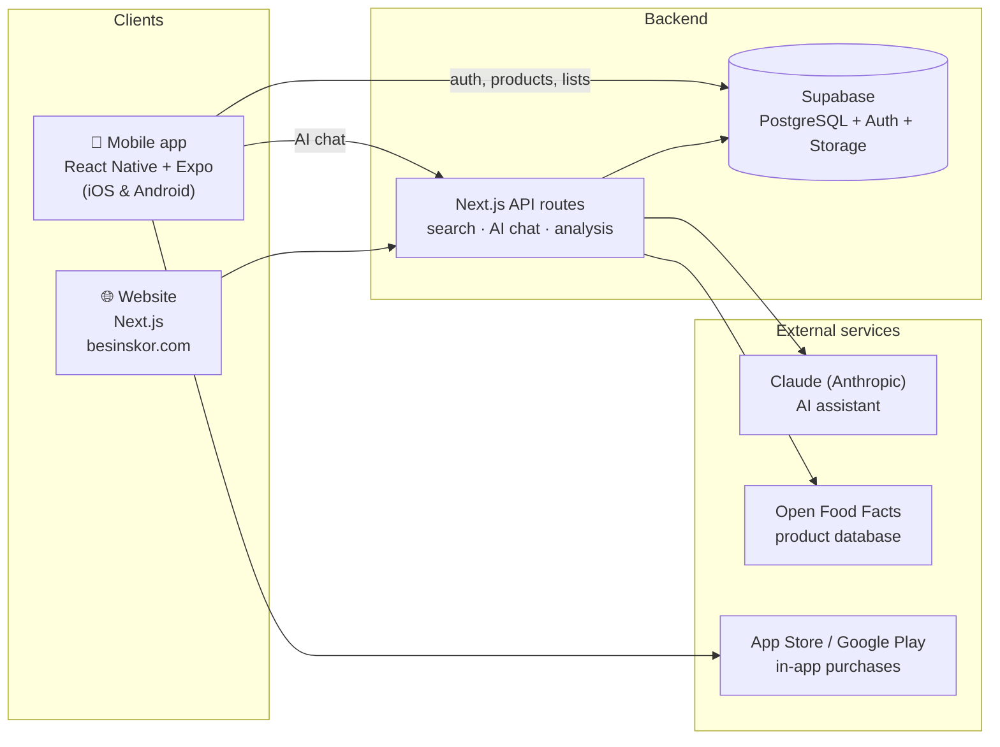

  

<h1 align="center">BesinSkor</h1>

  <b>Scan a food product, understand what you eat.</b> 
  A mobile app that rates packaged food sold in Türkiye from <b>A to E</b> and explains the result with an AI nutrition assistant.

  
  
  
  

> **Note:** BesinSkor is a commercial product, so its source code is private. This repository presents the project: what it does, how it is built, and what I learned. A detailed technical overview is available as a PDF: **[docs/besinskor-overview.pdf](docs/besinskor-overview.pdf)**.

---

## Screenshots

  
  
  
  
  

*(The app is in Turkish: its first market is Türkiye.)*

---

## The problem

Nutrition labels are hard to read in a supermarket aisle. In Türkiye, most packaged products show no simple front-of-pack score, so it is hard to compare two products quickly or to know whether a product is a healthy choice.

## The solution

BesinSkor turns the nutrition label into **one clear score**:

1. **Scan** the barcode with the phone camera, or search by name or brand.
2. **See the score**: a letter from **A** (best) to **E**, plus a score out of 100 and the product's level of processing.
3. **Understand it**: ask the AI assistant *“Why this score?”*, *“Is there a better alternative?”* or *“Is this good for protein?”*.

---

## Features

| | Feature | Details |
|---|---|---|
| 📷 | **Barcode scanner** | Instant lookup by barcode, with a fallback to the Open Food Facts database for international products |
| 🅰️ | **A–E health score** | Based on the 2023 Nutri-Score algorithm, adapted per food category and converted to a score out of 100; the NOVA processing level is shown separately |
| 🤖 | **AI nutrition assistant** | Chat about a product or about your diet, with the product's data given to the model as context |
| ⚖️ | **Compare** | Two products side by side |
| 📋 | **My List** | Daily list of what you eat, with statistics and streaks |
| 🧑 | **Nutrition profile** | Gender, age, goal, height and weight, to personalise the advice |
| ➕ | **Community products** | Users can submit a missing barcode with photos; submissions are moderated before being published |
| ⭐ | **BesinSkor Plus** | Monthly and yearly subscriptions with a 7-day free trial, through Apple and Google in-app purchases |
| 🔔 | **Notifications** | Reminders and limit notifications |

---

## Architecture

- **One backend for two clients**: the mobile app and the website share the same Supabase database and the same API routes.
- **The score is computed by a transparent algorithm, not by the AI.** The AI only *explains* the result, so the score stays consistent and explainable.
- **Security**: row-level security in PostgreSQL, a daily AI message quota, and protected moderation actions.

## Tech stack

| Layer | Technologies |
|---|---|
| Mobile | React Native 0.81, Expo SDK 54, TypeScript, React Navigation, expo-camera, expo-iap, expo-notifications |
| Web | Next.js 16 (App Router), React 19, TypeScript, Tailwind CSS |
| Backend | Supabase (PostgreSQL, Auth, Storage), Next.js API routes on Vercel |
| AI | Claude (Anthropic API) |
| Data | Own product database + Open Food Facts API, data-quality scripts in Node.js |
| Release | EAS Build and Submit, App Store Connect, Google Play Console |

---

## Timeline

| Date | Milestone |
|---|---|
| 2026 | Idea, scoring algorithm and website |
| June 2026 | **First release on the App Store** (Health & Fitness category) |
| November 2026 | Version 1.0.6: BesinSkor Plus subscriptions, redesigned home screen, AI limits |
| In progress | Android public release, English and French versions of the app |

## What I learned

- **Shipping a real product end to end**: from the idea to the App Store, including App Review rejections and how to fix them
- **Mobile development** with React Native and Expo for two platforms from one codebase
- **Backend design** with PostgreSQL, authentication, file storage and row-level security
- **Integrating an LLM in a product**: giving it the right context, controlling cost with quotas, and keeping decisions explainable
- **Payments**: in-app subscriptions, free trials and store rules on both Apple and Google
- **Working with real users**: bug reports, community submissions and moderation

---

  Designed, built and published by <b>Görkem Özbek</b> 
  <a href="https://besinskor.com">besinskor.com</a> · <a href="https://apps.apple.com/tr/app/besinskor/id6783465565">App Store</a>

